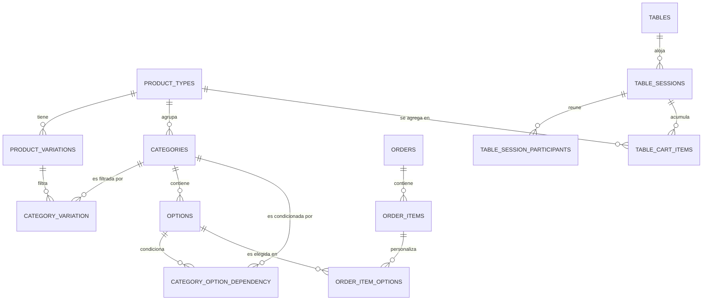

# Análisis de Arquitectura y Base de Datos - Sistema de Pedidos Personalizados

Este documento contiene un análisis detallado del diseño del software **Deliburrito**, estructurado para servir como guía técnica para su replicación y adaptación a un negocio de **sushi** (ej. "DeliSushi").

---

## 🏗️ 1. Arquitectura General del Sistema

El sistema utiliza una arquitectura desacoplada moderna y minimalista con comunicación cliente-servidor:

```mermaid
graph TD
    subgraph Frontend [React SPA (Vite + Tailwind)]
        UI[Pantalla de Armado / Builder]
        Cart[Carrito y Duplicado]
        Checkout[Formulario de Envío]
    end

    subgraph Backend [Laravel 11 API & Admin Panel]
        Routes[Web Routes - routes/web.php]
        Controller[Controllers: MenuController, OrderController]
        Auth[AuthController - Sesión Admin]
        AdminPanel[Admin Dashboard - Single File SPA HTML/JS]
    end

    subgraph Database [MySQL 8+]
        DB[(Tablas Relacionales)]
    end

    UI -->|GET /menu & /variations| Routes
    Checkout -->|POST /orders| Routes
    Routes --> Controller
    Controller --> DB
    AdminPanel -->|GET/POST/PUT/DELETE API| Routes
```

### Frontend (React + Vite + Tailwind CSS)
*   **Tecnologías:** React 18, Vite (para desarrollo rápido con HMR y compilación optimizada), Tailwind CSS para los estilos de la interfaz.
*   **Comportamiento:** SPA (Single Page Application). Gestiona el estado de selección en caliente, maneja un carrito local persistido en estado, permite duplicar productos con lógica inteligente para remover ingredientes adicionales de la copia y realiza peticiones HTTP Fetch al backend.

### Backend (Laravel 11 + PHP 8.2+)
*   **Motor Principal:** Laravel 11 configurado de forma ultra-ligera (sin APIs sobrediseñadas, usando rutas de sesión y cookies para seguridad CSRF integrada con Sanctum).
*   **Admin Panel:** Localizado en `backend/public/admin/index.html`. Es un dashboard SPA en un único archivo HTML pesado (100KB+) impulsado por Tailwind CSS CDN y Javascript puro (fetch), lo cual simplifica drásticamente el despliegue al no requerir compilación compleja en el servidor para la administración.

---

## 🗄️ 2. Organización y Diseño de la Base de Datos

La base de datos está diseñada con un modelo relacional altamente dinámico para soportar alimentos personalizables por pasos. A continuación se presenta el modelo físico de tablas:



### Detalle de Tablas y Columnas

#### 1. `product_types` (Tipos de Producto Principal)
Representa los módulos o tipos de comida disponibles (ej. Burritos, Hamburguesas, o para el nuevo negocio: *Rolls, Combos, Handrolls, Woks*).
*   `id` (BIGINT UNSIGNED, PK)
*   `name` (VARCHAR): Nombre del tipo de producto (ej. "Sushi Roll").
*   `slug` (VARCHAR, UNIQUE): Identificador único URL/API (ej. "sushi-roll").
*   `description` (TEXT): Descripción visible en la app.
*   `emoji` (VARCHAR): Icono decorativo (ej. "🍣").
*   `order_index` (INT): Orden de renderizado en las pestañas del menú.
*   `is_active` (TINYINT/BOOLEAN): Estado lógico de visibilidad.
*   `image_path` (VARCHAR): Ruta de la imagen del módulo de comida.

#### 2. `product_variations` (Variaciones de Producto)
Define el tamaño, combo o variante base del producto que dicta el precio inicial (ej. *Roll de 10 Bocados, Roll de 5 Bocados*).
*   `id` (BIGINT UNSIGNED, PK)
*   `product_target` (VARCHAR): Apunta al `slug` de `product_types`.
*   `name` (VARCHAR): Nombre de la variación (ej. "Maki x10", "Maki x5").
*   `description` (VARCHAR): Detalle corto.
*   `price` (DECIMAL 10,2): Precio base de esta variación.
*   `is_active` (TINYINT/BOOLEAN): Habilitación lógica.

#### 3. `categories` (Categorías de Selección o Pasos)
Son los grupos de ingredientes/pasos obligatorios u opcionales por los que pasa el usuario (ej. *Proteína, Cobertura, Salsa, Bebida*).
*   `id` (BIGINT UNSIGNED, PK)
*   `product_type` (VARCHAR): Apunta al `slug` de `product_types` para saber en qué menú renderizarse.
*   `name` (VARCHAR): Nombre del paso (ej. "Elige tu Proteína", "Elige tus Toppings").
*   `is_required` (TINYINT/BOOLEAN): Si es obligatorio seleccionar al menos una opción para continuar.
*   `is_addon` (TINYINT/BOOLEAN): Identifica si son adiciones extra de cobro adicional (útil en el checkout para lógicas de duplicación).
*   `show_in_summary` (TINYINT/BOOLEAN): Determina si se lista en el resumen de ingredientes en el carrito.
*   `max_selections` (INT): Número máximo de ingredientes seleccionables en este paso.
*   `order_index` (INT): Orden del paso en el formulario.
*   `allow_quantity` (TINYINT/BOOLEAN): Permite que el usuario asigne cantidades a las opciones (ej. *x2 de Queso Philadelphia*).
*   `is_active` (TINYINT/BOOLEAN): Habilitación lógica.

#### 4. `options` (Opciones de Ingredientes/Productos)
Los elementos seleccionables dentro de cada paso/categoría.
*   `id` (BIGINT UNSIGNED, PK)
*   `category_id` (BIGINT UNSIGNED, FK -> `categories.id`): Categoría a la que pertenece.
*   `name` (VARCHAR): Nombre del ingrediente/adición (ej. "Salmón Fresco", "Ebi Tempura", "Aguacate").
*   `price` (DECIMAL 10,2): Costo adicional o recargo por elegir esta opción (0.00 si está incluido en el precio base).
*   `is_active` (TINYINT/BOOLEAN): Habilitación lógica.

#### 5. `category_variation` (Pivot de Visibilidad de Pasos por Variación)
Permite que un paso de selección solo aparezca si se elige cierta variación (ej. El paso "Elige 2 Proteínas" solo es visible si se selecciona la variación "Maki x10", mientras que en "Maki x5" se oculta o se reemplaza por uno de menor cantidad).
*   `id` (BIGINT UNSIGNED, PK)
*   `category_id` (BIGINT UNSIGNED, FK -> `categories.id`)
*   `product_variation_id` (BIGINT UNSIGNED, FK -> `product_variations.id`)

#### 6. `category_option_dependency` (Dependencia de Visibilidad Condicional)
Lógica avanzada para habilitar un paso completo basado en una opción previa específica.
*   `id` (BIGINT UNSIGNED, PK)
*   `category_id` (BIGINT UNSIGNED, FK -> `categories.id`): Categoría que se ocultará/mostrará.
*   `option_id` (BIGINT UNSIGNED, FK -> `options.id`): Opción desencadenante (si esta opción se selecciona en el frontend, se muestra esta categoría dependiente).

#### 7. `orders` (Pedidos Cabecera)
Información de despacho e identificación del cliente.
*   `id` (BIGINT UNSIGNED, PK)
*   `customer_name` (VARCHAR): Nombre del cliente.
*   `customer_phone` (VARCHAR): Teléfono del cliente.
*   `customer_address` (VARCHAR, NULL): Dirección física (solo para envíos a domicilio).
*   `table_number` (VARCHAR, NULL): Número de mesa (solo si es consumo en local).
*   `delivery_type` (ENUM: `domicilio`, `local`, `recoger`): Tipo de servicio.
*   `delivery_cost` (DECIMAL 10,2): Costo de envío (leído de la tabla `settings`).
*   `subtotal` (DECIMAL 10,2): Suma de todos los ítems agregados al carrito.
*   `total` (DECIMAL 10,2): `subtotal` + `delivery_cost`.
*   `status` (ENUM: `pendiente`, `aceptado`, `cancelado`): Estado actual.
*   `observations` (TEXT, NULL): Comentarios adicionales del cliente.

#### 8. `order_items` (Líneas de Detalle del Pedido)
Cada producto personalizado ordenado.
*   `id` (BIGINT UNSIGNED, PK)
*   `order_id` (BIGINT UNSIGNED, FK -> `orders.id`)
*   `product_type` (VARCHAR): Tipo de producto (ej. "sushi-roll").
*   `variation_name` (VARCHAR): Variación elegida (ej. "Maki x10").
*   `item_total` (DECIMAL 10,2): Precio final calculado de este ítem (Precio base variación + Opciones con recargo).
*   `notes` (TEXT, NULL): Notas de preparación (ej. "Sin cebollín").

#### 9. `order_item_options` (Opciones Seleccionadas en la Línea)
Detalle de los ingredientes elegidos para ese ítem personalizado.
*   `id` (BIGINT UNSIGNED, PK)
*   `order_item_id` (BIGINT UNSIGNED, FK -> `order_items.id`)
*   `option_id` (BIGINT UNSIGNED, FK -> `options.id`)
*   `quantity` (INT, DEFAULT 1): Cantidad seleccionada del ingrediente.
*   `price_charged` (DECIMAL 10,2): Copia del precio cobrado en el momento de la compra (para histórico).

#### 10. `settings` (Ajustes de Configuración General)
*   `id` (BIGINT UNSIGNED, PK)
*   `key` (VARCHAR, UNIQUE): Clave del ajuste (ej. `costo_domicilio`, `comercio_abierto`).
*   `value` (LONGTEXT): Valor de configuración.
*   `description` (VARCHAR): Notas del parámetro.

#### 11. `tables` (Mesas Físicas)
Control de mesas del restaurante para pedidos colaborativos vía QR.
*   `id` (BIGINT UNSIGNED, PK)
*   `number` (INT, UNIQUE): Número físico de la mesa visible en sala.
*   `qr_hash` (VARCHAR, UNIQUE): Token criptográfico secreto (32 caracteres hexadecimales) que compone la URL de escaneo `?mesa=HASH`.
*   `status` (ENUM: `'free'`, `'occupied'`, `'locked'`): Estado operativo de la mesa.

#### 12. `table_sessions` (Sesiones Activas de Sala Colaborativa)
Representa la sala multijugador iniciada por un comensal anfitrión (Host).
*   `id` (BIGINT UNSIGNED, PK)
*   `table_id` (BIGINT UNSIGNED, FK -> `tables.id`, CASCADE)
*   `host_device_id` (VARCHAR): Huella digital del dispositivo del anfitrión para control de privilegios.
*   `last_active_at` (TIMESTAMP): Registro de Heartbeat para expirar mesas inactivas.

#### 13. `table_session_participants` (Participantes del Lobby 2D)
Registra a cada comensal sentado a la mesa antes y durante el armado del pedido.
*   `id` (BIGINT UNSIGNED, PK)
*   `table_session_id` (BIGINT UNSIGNED, FK -> `table_sessions.id`, CASCADE)
*   `guest_name` (VARCHAR): Nombre del comensal.
*   `role` (ENUM: `'host'`, `'guest'`): Rol del participante (Host con corona y permisos de envío a cocina).
*   `status` (ENUM: `'deciding'`, `'ready'`): Estado visual del comensal en la mesa 2D.

#### 14. `table_cart_items` (Carrito Colaborativo en Memoria de BD)
Acumula los platos armados por los diferentes comensales antes de consolidar el pedido final.
*   `id` (BIGINT UNSIGNED, PK)
*   `table_session_id` (BIGINT UNSIGNED, FK -> `table_sessions.id`, CASCADE)
*   `guest_name` (VARCHAR): Nombre del comensal autor del plato (permite edición/eliminación restringida solo a su autor).
*   `product_id` (BIGINT UNSIGNED, FK -> `product_types.id`)
*   `details` (JSON): Configuración exacta del burrito/plato (variación, opciones, resumen).
*   `price` (DECIMAL 10,2): Precio calculado del ítem.

---

## 🍣 3. Plan de Adaptación para un Negocio de Sushi

Para clonar esta plataforma para una sucursal de **Sushi**, la mayor parte del código de backend y frontend no requiere alteración de lógica pura, sino una reestructuración de catálogos mediante **Seeders** y sutiles cambios estéticos:

### Paso 1: Configurar Tipos de Producto (`product_types`)
Registrar las categorías principales del restaurante de sushi:
1.  **Rolls Completos (Makis)** (slug: `roll-maki`, emoji: `🍣`)
2.  **Combos de Sushi** (slug: `combo-sushi`, emoji: `🍱`)
3.  **Entradas (Gyoza, Spring rolls)** (slug: `entradas`, emoji: `🥟`)
4.  **Bebidas y Postres** (slug: `bebidas`, emoji: `🥤`)

### Paso 2: Definir las Variaciones (`product_variations`)
Para la preparación personalizada (ej. en `roll-maki`):
*   Variación: **Maki Rollo Completo (10 bocados)** -> Precio: `$28,000`
*   Variación: **Maki Medio Rollo (5 bocados)** -> Precio: `$16,000`

### Paso 3: Configurar las Categorías/Pasos (`categories`)
Se define el flujo del "Sushi Builder" según el tipo de producto `roll-maki`:
1.  **Paso 1: Proteína Interna** (Required: 1, Max: 2) -> (Salmón, Atún, Langostino tempura, Tofu).
2.  **Paso 2: Acompañante Interno** (Required: 1, Max: 2) -> (Aguacate, Queso crema, Pepino, Mango).
3.  **Paso 3: Cobertura Externa** (Required: 0, Max: 1) -> (Ajonjolí, Plátano maduro, Panko crunch, Masago).
4.  **Paso 4: Salsas** (Required: 0, Max: 2) -> (Teriyaki, Acevichada, Sriracha mayo, Soya).
5.  **Paso 5: Bebidas o Adicionales** (Is Addon: true) -> (Bebidas, adición de jengibre extra, wasabi).

### Paso 4: Cargar los Ingredientes (`options`)
Asociar a cada categoría sus opciones y sobrecostos correspondientes (ej. Salmón tiene costo adicional, Pepino es `$0`).

---

## 🛠️ 4. Flujo de Datos Crítico (Creación de Pedidos)

Cuando el cliente da clic en "Confirmar Pedido" en el frontend React:

```
[React SPA]
  │
  ├─> 1. Valida el carrito en memoria (Precios correctos).
  ├─> 2. Lanza POST a /orders con estructura JSON limpia:
  │      {
  │        "customer_name": "Sergio Lozano",
  │        "customer_phone": "3001234567",
  │        "delivery_type": "domicilio",
  │        "items": [
  │          {
  │            "product_type": "roll-maki",
  │            "variation_name": "Maki Rollo Completo",
  │            "item_total": 31000,
  │            "options": [
  │               { "option_id": 12, "quantity": 1 },  // Salmón
  │               { "option_id": 15, "quantity": 1 }   // Queso crema
  │            ]
  │          }
  │        ]
  │      }
  │
[Laravel 11 Backend (OrderController@store)]
  │
  ├─> 3. Abre una transacción de base de datos (DB::transaction).
  ├─> 4. Valida parámetros de entrada (Sanitiza notas/observaciones).
  ├─> 5. Obtiene el 'costo_domicilio' desde `settings`.
  ├─> 6. Inserta registro en `orders`.
  ├─> 7. Recorre cada ítem, inserta en `order_items` y sus opciones elegidas en `order_item_options`.
  ├─> 8. Recalcula Subtotal + Domicilio y actualiza cabecera del pedido.
  ├─> 9. Cierra Transacción.
  │
[Admin Dashboard]
  │
  └─> 10. Recibe notificación reactiva o por intervalo (polling) del nuevo pedido.
```

---

## 💡 5. Buenas Prácticas del Repositorio a Mantener
1.  **Normalización de Precios:** Las tablas `options` y `product_variations` usan un campo unificado `price`. Evitar redundancia de columnas como `price_base` o `price_extra`.
2.  **Lógica del Carrito (Duplicación):** El frontend React cuenta con un sistema inteligente de duplicación que consulta `/menu` para identificar si el ingrediente duplicado es un adicional (`is_addon`). Si lo es, pregunta al usuario mediante un modal interactivo si desea copiar el plato con o sin las adiciones extras pagas, recalculando el precio final de forma limpia en caliente.
3.  **Rate Limiting:** El endpoint de órdenes `/orders` cuenta con protección throttle en el backend (`middleware('throttle:10,1')`) para evitar ataques de inyección de pedidos falsos o spamming.

---
*Análisis desarrollado para la replicación del sistema en el nuevo software de Sushi.*
